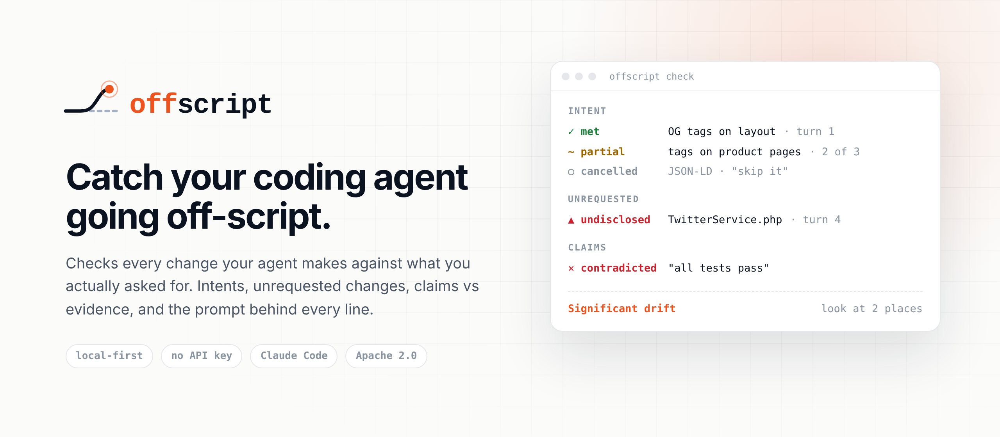
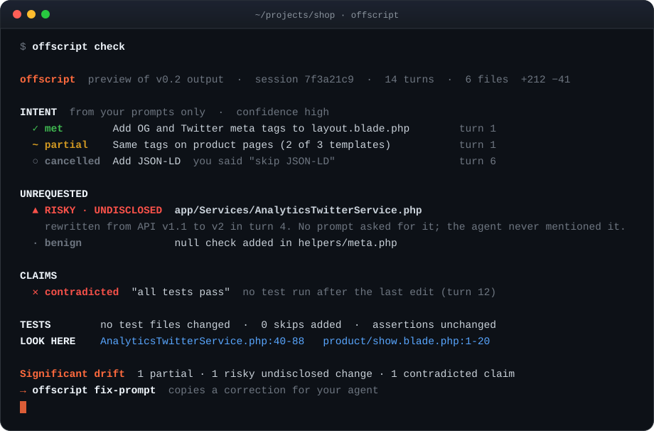
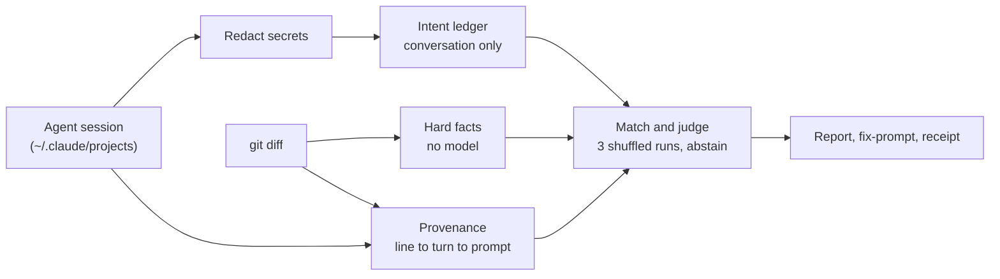

<a href="https://github.com/SujalKrG/offscript">
  <picture>
    <source media="(prefers-color-scheme: dark)" srcset="assets/cover-dark.png">
    <source media="(prefers-color-scheme: light)" srcset="assets/cover-light.png">
    
  </picture>
</a>

<p align="center">
  <a href="#quick-start"><b>Quick start</b></a> ·
  <a href="#how-it-works"><b>How it works</b></a> ·
  <a href="#roadmap"><b>Roadmap</b></a> ·
  <a href="research/"><b>Research</b></a> ·
  <a href="CONTRIBUTING.md"><b>Contributing</b></a>
</p>

<p align="center">
  <a href="https://github.com/SujalKrG/offscript/actions/workflows/ci.yml"></a>
  <a href="LICENSE"></a>
  
</p>

<br>

> [!IMPORTANT]
> offscript is at **v0.0 (spike)**. It reads real Claude Code sessions today, extracts intents, hard facts and line provenance, and writes a report per session. The judge, the CLI and the hooks land in v0.1 and v0.2. See the [roadmap](#roadmap).

---

## Why

Coding agents are great right up until they quietly:

- **rewrite a file you never mentioned**, and don't tell you ([claude-code#64473](https://github.com/anthropics/claude-code/issues/64473)),
- **refactor half a module when you asked for one `if`** ([claude-code#54240](https://github.com/anthropics/claude-code/issues/54240)),
- **say "all tests pass"** when no test ran after the last edit,
- **edit or skip the tests** so they go green,
- **ignore the rules** you wrote in `CLAUDE.md`.

AI code reviewers check whether code is *good*. Nothing checks whether it is **what you asked for**. Meta built exactly that internally ([ARCTIC](https://arxiv.org/abs/2607.29516)) and never released it. offscript is the open, local-first version, built for the session that is already on your disk.

## What it checks

<p align="center">
  
</p>
<p align="center"><sub><i>Preview of the v0.2 terminal report. The v0.0 spike in this repo already writes these sections as a Markdown report.</i></sub></p>

| Check | What you get | Model needed | Status |
|---|---|:---:|:---:|
| **Intent ledger** | Every request from your prompts as a checklist with its source quote; cancelled and superseded requests tracked | small, via your CLI | v0.0 |
| **Provenance** | Which turn and prompt wrote each changed line; your own edits kept separate | no | v0.0 |
| **Hard facts** | Deleted files, removed exports, dependency, config, CI, migration and auth changes | no | v0.0 |
| **Test integrity** | Tests edited, assertions removed, `skip`/`only` added | no | v0.0 |
| **Claims vs evidence** | "all tests pass" checked against the test runs actually in the session | no | v0.0 |
| **Unrequested changes** | Changes no prompt asked for, ranked risky or benign | partly | v0.0 (file level), v0.1 (hunk level) |
| **Disclosure check** | Risky changes the agent made but never mentioned | partly | v0.0 (file level), v0.2 |
| **Intent verdicts** | Each request met, partial or unmet, with the evidence hunk; "uncertain" instead of guessing | yes | v0.1 |
| **Standing rules** | Your `CLAUDE.md` / `AGENTS.md` rules checked against the change | partly | v0.2 |
| **Fix-prompt** | A ready-to-paste correction for your agent | yes | v0.2 |

## Quick start

> [!NOTE]
> Requires [Bun](https://bun.sh) 1.4+, git, and Claude Code installed and logged in. Without Claude Code, add `--no-llm` to get facts and provenance only.

```bash
git clone https://github.com/SujalKrG/offscript.git
cd offscript
bun install
bun test

# sessions Claude Code recorded for one of your repos
bun run spike --repo /path/to/your-repo --list

# reports for the 10 most recent sessions that edited it
bun run spike --repo /path/to/your-repo --limit 10
```

Reports land in `spike-results/<repo>/`, one Markdown file per session plus a `summary.md`. That folder is gitignored: it holds excerpts of your private sessions, with secrets already redacted.

<details>
<summary><b>All spike options</b></summary>

| Flag | Meaning |
|---|---|
| `--repo <path>` | Repo to review (default: current folder) |
| `--limit <n>` | Number of sessions (default 10) |
| `--session <id-prefix>` | One specific session |
| `--base <ref> --head <ref>` | Review an explicit range instead of auto-detecting |
| `--no-llm` | Skip the model; facts and provenance only |
| `--include-empty` | Include sessions with no edits |
| `--out <dir>` | Output folder (default `spike-results`) |

| Environment variable | Meaning |
|---|---|
| `CLAUDE_CONFIG_DIR` | Where your Claude Code data lives, if not `~/.claude` |
| `OFFSCRIPT_CLAUDE_BIN` | Full path to a specific `claude` binary |
| `OFFSCRIPT_MODEL` | Model alias for the judge (default `haiku`) |

**How a session's change is chosen:** explicit `--base/--head` first; else the commits made on the current branch during the session, extended to the working tree if the session also left uncommitted edits; else uncommitted changes against `HEAD`.

</details>

## How it works



Five rules every feature follows:

1. **Facts before opinions.** Deleted exports, skipped tests and dependency changes are computed, not judged, and no model can overrule them.
2. **The judge never sees both sides at once.** Intents are extracted without the code; the code is described without the intents. Then they are matched. (The leakage rule from Meta's ARCTIC.)
3. **Evidence or silence.** Every finding cites a prompt quote or a diff hunk. No style comments, ever.
4. **Abstain instead of guess.** When repeated judge runs disagree, the item is marked *uncertain*.
5. **Local first.** Your transcripts stay on your machine. Only redacted excerpts go to the model you already use.

## No API key needed

offscript uses the agent you already pay for, in headless mode, on its cheapest model:

| Order | Backend | Auth |
|---|---|---|
| 1 | Claude Code (`claude -p --model haiku`), or Codex (planned), the *other* agent judging when both are installed | your existing login |
| 2 | Any API key (Anthropic, OpenAI, OpenAI-compatible) | your key (planned) |
| 3 | Local model via Ollama | none (planned) |
| 4 | Facts only | none |

Judge calls run from an empty temp folder in safe mode: no tools, no hooks, no `CLAUDE.md`, no session file left behind. A typical intent extraction costs about **$0.001**.

## Privacy

- Transcripts are read locally and never uploaded.
- Secrets (API keys, tokens, private keys, credentials in URLs and assignments) are redacted **before** anything is stored, printed or sent to a model.
- The model sees your prompts and your rules file, never your code, during intent extraction.
- Reports are written to a gitignored folder.

Found a way data leaks? See [SECURITY.md](SECURITY.md).

## How it compares

| | Checks against your request | Reads the agent session | Line-level provenance | Hard facts first | Open source, local |
|---|:---:|:---:|:---:|:---:|:---:|
| AI code reviewers (CodeRabbit, Copilot review, Greptile) | no | no | no | partly | mostly no |
| Session recorders (Entire, Git AI, Agent Trace) | no | yes | yes | no | yes |
| Scope hooks (e.g. scope-guard) | file names only | prompt only | no | no | yes |
| Spec checkers (e.g. onspec) | against spec files you write | no | no | yes | yes |
| Meta ARCTIC | yes | yes | no | no | internal only |
| **offscript** | **yes** | **yes** | **yes** | **yes** | **yes** |

offscript reads recorders' formats as inputs rather than competing with them.

## Roadmap

- [x] **v0.0 Spike:** Claude Code reader, secret redaction, intent ledger via headless Claude Code, hard facts, test-integrity facts, line provenance, claim check for tests, Markdown report with labels
- [ ] **v0.1 Judge:** per-intent verdicts with evidence hunks, consensus judge with abstention, hunk-level unrequested changes, Drift Bench (mutation benchmark) with published numbers
- [ ] **v0.2 CLI:** `offscript` command, Codex reader, Claude Code and Codex hooks, standing-rule checks, disclosure check, fix-prompt, SARIF output
- [ ] **v0.3 Ship:** drift receipts in git notes, GitHub Action, single binaries, Claude Code plugin marketplace
- [ ] **v0.4 Connect:** Entire, Git AI and Agent Trace adapters; local judge presets

## Research

offscript is built on public research, and every decision is written down.

| | Note | What's inside | Read |
|:---:|---|---|:---:|
| **01** | **[ARCTIC, reverse engineered](research/arctic-deep-study.md)** | Meta's internal intent, drift and spotlight system, piece by piece, with every weakness and its fix | 18&nbsp;min |
| **02** | **[Gaps and complaints](research/gaps-complaints-feasibility.md)** | What Meta left unsolved, what developers actually report, and whether each fix is buildable | 20&nbsp;min |
| **03** | **[Design spec](research/design-spec.md)** | The full pipeline, the innovations, the stack, and the publishing plan | 15&nbsp;min |

## Contributing

> [!TIP]
> **The fastest way to help:** run the spike on one of your own repos and [share a case](https://github.com/SujalKrG/offscript/issues/new?template=wrong_verdict.yml) where your agent went off-script, or where offscript got it wrong. Every case becomes part of the benchmark.

Good first contributions:

- **A redacted off-script case** from your own sessions (the report, never the raw transcript)
- **A wrong verdict:** a false positive or a miss, with what you expected instead
- **A parser fixture** for a Claude Code or Codex version that breaks the reader

Setup, the five rules and the PR checklist are in [CONTRIBUTING.md](CONTRIBUTING.md).

<br>

<a href="https://github.com/SujalKrG/offscript">
  <picture>
    <source media="(prefers-color-scheme: dark)" srcset="assets/footer-dark.png">
    <source media="(prefers-color-scheme: light)" srcset="assets/footer-light.png">
    
  </picture>
</a>

<p align="center"><sub><a href="LICENSE">Apache 2.0</a> · <a href="SECURITY.md">Security</a> · <a href="CODE_OF_CONDUCT.md">Code of conduct</a> · <a href="CHANGELOG.md">Changelog</a></sub></p>
