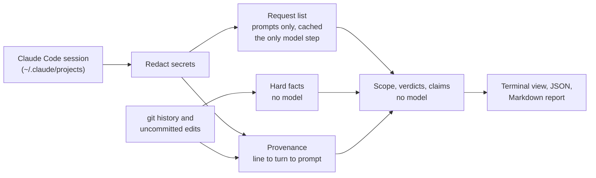

<a href="https://github.com/SujalKrG/offscript">
  <picture>
    <source media="(prefers-color-scheme: dark)" srcset="assets/cover-dark.png">
    <source media="(prefers-color-scheme: light)" srcset="assets/cover-light.png">
    
  </picture>
</a>

<p align="center">
  <a href="#quick-start"><b>Quick start</b></a> ·
  <a href="#how-it-works"><b>How it works</b></a> ·
  <a href="#roadmap"><b>Roadmap</b></a> ·
  <a href="research/"><b>Research</b></a> ·
  <a href="CONTRIBUTING.md"><b>Contributing</b></a>
</p>

<p align="center">
  <a href="https://github.com/SujalKrG/offscript/actions/workflows/ci.yml"></a>
  <a href="LICENSE"></a>
  
</p>

<br>

> [!IMPORTANT]
> offscript is **v0.1 in progress**. It runs today: `offscript review` reads a Claude Code session and tells you, with evidence, whether each request was done, whether the agent changed only what you asked, and whether its claims hold up. Agent Trace export and the Drift Bench are not built yet. See the [roadmap](#roadmap).

---

## Why

Coding agents are great right up until they quietly:

- **rewrite a file you never mentioned**, and don't tell you ([claude-code#64473](https://github.com/anthropics/claude-code/issues/64473)),
- **refactor half a module when you asked for one `if`** ([claude-code#54240](https://github.com/anthropics/claude-code/issues/54240)),
- **say "all tests pass"** when no test ran after the last edit,
- **edit or skip the tests** so they go green,
- **ignore the rules** you wrote in `CLAUDE.md`.

AI code reviewers check whether code is *good*. Nothing checks whether it is **what you asked for**. Meta built exactly that internally ([ARCTIC](https://arxiv.org/abs/2607.29516)) and never released it. offscript is the open, local-first version, built for the session that is already on your disk.

## What it checks

<p align="center">
  
</p>
<p align="center"><sub><i>Design preview, not current output. The picture predates the CLI and its wording and layout differ from what `offscript review` prints today. Real output is below.</i></sub></p>

What `offscript review` prints today (sample output):

```
offscript  e34d1222  2026-10-14 11:15  44 requests, 19 edits, 98% traced

  Did what you asked    ✔ 28 done  ✘ 1 not done  ? 10 unclear
  Only what you asked   ~ 2 unexplained files
  Told the truth        ✔ 33 claims verified

  Problems
  ✘ I1 "Move the driver, admin and backend apps from the..."  not in change: 3 edit(s) made in these turns, none of them in the reviewed change
  ~ api/src/modules/rides/rides.routes.ts  not asked for, never mentioned (not linked to anything asked for)

  Full report  .offscript/reports/2026-10-14-e34d1222.md
```

| Check | What you get | Model needed | Status |
|---|---|:---:|:---:|
| **Request list** | Your prompts split into requests, each with a source quote; cancelled and superseded requests tracked | yes, once per session, via your Claude Code CLI (or an offline heuristic with `--no-llm`) | built |
| **Provenance** | Which turn and prompt wrote each changed line; other sessions' and your own lines kept separate | no | built |
| **Hard facts** | Deleted files, removed exports, dependency, config, CI, migration and auth changes | no | built |
| **Test integrity** | Tests edited, assertions removed, `skip`/`only` added | no | built |
| **Verdict per request** | done, partly done, failed, not done, not in change, answered, or needs judgment, decided from commands and code that landed, never from the agent's summary | no | built |
| **Claims vs evidence** | Claims in the agent's replies (tests pass, type check clean, committed, pushed, PR opened, merged, deployed, built, fixed) checked as verified, contradicted, stale, overstated, unsupported or unverified | no | built |
| **Silent gaps** | Requests left unfinished that the agent never mentioned | no | built |
| **Scope** | Each changed file marked anchor, related, derived, scratch or drift; only drift is flagged as undisclosed; sensitive files need direct evidence | no | built |
| **Against instruction** | Files you said not to touch ("don't touch auth") that the agent changed | no | built |
| **Standing rules** | Rules from `CLAUDE.md` / `AGENTS.md` beyond the "don't touch" case | no | planned |
| **Codex reader** | Review Codex sessions | no | planned |
| **Fix-prompt** | A ready-to-paste correction for your agent | no | planned |
| **SARIF output, Agent Trace export** | Findings for code scanning and for trace tools | no | planned |
| **Drift Bench** | A labelled benchmark with published numbers | no | planned |
| **GitHub Action, single binaries** | Run in CI without Bun | no | planned |

The model is used for one thing only: splitting your prompts into requests. Everything else in the "built" rows is computed from the transcript and git. Because verdicts, scope and claims start from that request list, a poor split gives poor verdicts; the report shows the list so you can see it.

## Quick start

> [!NOTE]
> Requires [Bun](https://bun.sh) 1.4+ and git. For the model step you also need Claude Code installed and logged in. Without it, offscript uses the offline heuristic and says so.

```bash
git clone https://github.com/SujalKrG/offscript.git
cd offscript
bun install

# review the latest Claude Code session that edited a repo
bun run offscript review --repo /path/to/your-repo

# same, fully offline (no Claude call)
bun run offscript review --repo /path/to/your-repo --no-llm

# list the repo's sessions, then review one by id prefix
bun run offscript list --repo /path/to/your-repo
bun run offscript review a1b2c3d4 --repo /path/to/your-repo

# print a one-line review and write a report after every Claude Code session
bun run offscript hook install --user
```

Use `--user` for the hook. The hook command holds the absolute path to this checkout, so a project-level `.claude/settings.json` would break for anyone who clones your repo somewhere else.

Reports are written to `<repo>/.offscript/reports/<date>-<id>.md`. They hold redacted excerpts of your private sessions, so add `.offscript/` to your `.gitignore`. offscript does not do it for you.

<details>
<summary><b>All options</b></summary>

`offscript review [session-id-prefix]`

| Flag | Meaning |
|---|---|
| `--repo <path>` | Repo to review (default: current folder) |
| `--no-llm` | Offline heuristic: one request per prompt that is not a follow-up like "yes". No `claude` process is started |
| `--full` | Print every request, claim and flagged file, not only the problems |
| `--json` | Machine-readable result, `schemaVersion: 1` |
| `--md <file>` | Write the Markdown report there instead of the default path |
| `--hook` | Read Claude Code hook JSON from stdin, review that session, print one line |
| `--fail-on never\|problems\|any` | When to exit 1. Default `never` |

`offscript list [--repo <path>] [--limit <n>] [--json]` shows id, date, prompts and edits per session.

`offscript hook install [--project|--user]` merges a `SessionEnd` hook (timeout 60 s) into Claude Code settings and keeps your other keys. Running it again changes nothing.

| Exit code | Meaning |
|:---:|---|
| 0 | Reviewed. This is the default even when problems were found |
| 1 | Problems found, only with `--fail-on problems` (or `any`, which also counts notes) |
| 2 | Usage error |
| 3 | No session found |
| 4 | Unexpected failure |

| Environment variable | Meaning |
|---|---|
| `CLAUDE_CONFIG_DIR` | Where your Claude Code data lives, if not `~/.claude` (also where `hook install --user` writes) |
| `OFFSCRIPT_CLAUDE_BIN` | Full path to a specific `claude` binary |
| `OFFSCRIPT_MODEL` | Model alias for the request split (default `haiku`) |
| `OFFSCRIPT_CACHE_DIR` | Where cached request lists are kept. Default: `$XDG_CACHE_HOME/offscript`, else `%LOCALAPPDATA%\offscript` on Windows, else `~/.cache/offscript` |
| `NO_COLOR` | Plain ASCII output |

The terminal view uses the real terminal width (minimum 60 columns) and shows at most 8 problems. When the model call fails or Claude Code is missing, the review falls back to the offline heuristic and says so.

**The hook is safe to leave on.** It waits 5 s for its input, caps the model call at 30 s, and never blocks the end of a session: any error becomes one line and exit code 0. It prints one `systemMessage` line.

**How a session's change is chosen:**

1. With `--base`/`--head` (spike only), exactly that range.
2. Otherwise, commits on any branch made during the session window (from 10 minutes before the session started to 2 hours after it ended) that touch a file the session edited. Merge commits are skipped.
3. Duplicate commits (rebase, cherry-pick, squash copies) are detected with `git patch-id` and counted once. At most 200 commits are read; older ones are named in the report.
4. Files in those commits that the session never edited are left out and counted.
5. Uncommitted edits to the session's files, in any worktree of the repo, are added. They are compared with Claude Code's backup from before the session touched the file when one exists, not with `HEAD`.
6. Lines written by parallel sessions are credited to those sessions. Edits by subagents count as part of the session.

</details>

<details>
<summary><b>The spike, for labelling and benchmarking</b></summary>

The v0.0 spike is kept for collecting labelled cases. It always asks the model fresh (no cache) so runs stay comparable, and writes one Markdown report per session plus a `summary.md` with a labelling block.

```bash
bun run spike --repo /path/to/your-repo --list
bun run spike --repo /path/to/your-repo --limit 10
bun run spike:score        # score the labels you filled in
```

Output goes to `spike-results/<repo>/`, which is gitignored.

| Flag | Meaning |
|---|---|
| `--repo <path>` | Repo to review (default: current folder) |
| `--limit <n>` | Number of sessions (default 10) |
| `--session <id-prefix>` | One specific session |
| `--base <ref> --head <ref>` | Review an explicit range instead of auto-detecting |
| `--no-llm` | Skip the model. No request list is built, so there are no verdicts or claims, only facts and provenance |
| `--include-empty` | Include sessions with no edits |
| `--out <dir>` | Output folder (default `spike-results`) |
| `--list` | List sessions and exit |

</details>

## How it works



Five rules every feature follows:

1. **Deterministic evidence first.** Deleted exports, skipped tests, dependency changes, verdicts and claim checks are computed from git and the transcript. No model can overrule them.
2. **The model only splits prompts into requests, and never sees code.** It gets your prompts, your rules file and the agent's last message. It never gets the diff or file contents.
3. **Evidence or silence.** Every finding cites a prompt quote, a command or a changed file. No style comments.
4. **"Needs judgment" and "not checked" instead of guessing.** When the evidence does not settle a request, or a constraint cannot be checked from files, the report says so.
5. **Local first.** Your transcripts stay on your machine. Only redacted prompts, the rules file and the agent's last message go to the model you already use.

The claim check follows published findings on agents overclaiming. [OverclaimBench](https://arxiv.org/html/2609.20812v2) defines an overclaim as a final report that the agent's own trajectory contradicts, and found that among runs with unfinished work, 80.4% were misleading. [Advani (2026)](https://tsukumo.ch/blog/ai-agents-false-success) found LLM judges near chance at catching false success (0.54 to 0.65 AUROC) while simple state checks reached 0.83 to 0.95. So offscript uses no LLM judge. Details and open questions are in [claim-checks.md](research/claim-checks.md).

Not built: a consensus or multi-run judge, and an abstention judge. Earlier design notes in `research/` describe them; the code does not have them.

## No API key needed

The request split uses the agent you already pay for, in headless mode, on its cheapest model, once per session. The result is cached by content, so reviewing the same session again is instant and free.

| Order | Backend | Auth | Status |
|---|---|---|---|
| 1 | Claude Code (`claude -p --model haiku`) | your existing login | built |
| 2 | Offline heuristic (`--no-llm`, or automatic fallback) | none | built |
| 3 | Codex, any API key, or a local model via Ollama | your key or none | planned |

The call runs from an empty temp folder and asks Claude Code for no tools, one turn and no session file. An older Claude Code CLI that rejects those flags gets a retry with fewer of them. Cost is whatever one short haiku call costs on your plan; offscript does not publish a figure.

## Privacy

- Transcripts are read locally and never uploaded.
- Secrets (API keys, tokens, private keys, credentials in URLs and assignments) are redacted when the transcript is read, before anything is stored, printed or sent to a model. Errors from the model call are redacted too, and terminal escape codes in transcript text are stripped before printing.
- The model sees your prompts, the first 4000 characters of your `CLAUDE.md` or `AGENTS.md`, and the last 2000 characters of the agent's final message. It never sees your code or the diff.
- Reports go to `<repo>/.offscript/reports/`. Add `.offscript/` to your `.gitignore`; offscript does not.
- The request cache holds model output (the request list), keyed by a hash of its input. It lives outside your repo.

Found a way data leaks? See [SECURITY.md](SECURITY.md).

## How it compares

| | Checks against your request | Reads the agent session | Line-level provenance | Hard facts first | Open source, local |
|---|:---:|:---:|:---:|:---:|:---:|
| AI code reviewers (CodeRabbit, Copilot review, Greptile) | no | no | no | partly | mostly no |
| Session recorders (Entire, Git AI, Agent Trace) | no | yes | yes | no | yes |
| Scope hooks (e.g. scope-guard) | file names only | prompt only | no | no | yes |
| Spec checkers (e.g. onspec) | against spec files you write | no | no | yes | yes |
| Meta ARCTIC | yes | yes | no | no | internal only |
| **offscript** | **yes** | **yes** | **yes** | **yes** | **yes** |

Today offscript reads Claude Code sessions only. Reading recorders' formats (Entire, Git AI, Agent Trace) as inputs is planned, not built. The rows for other tools are summaries from the [research notes](research/), not tests of those tools.

## Roadmap

- [ ] **v0.1 Review (in progress):** modules 1 to 6
  - [x] 1. Scope check: anchor, related, derived, scratch and drift files; only drift is undisclosed; against-instruction
  - [x] 2. Verdict per request from evidence
  - [x] 3. Claim check and silent gaps
  - [x] 4. `offscript` CLI: `review`, `list`, `hook install`, `--no-llm`, `--json`, hook, cache
  - [ ] 5. Agent Trace export
  - [ ] 6. Drift Bench (labelled benchmark with published numbers)
- [ ] **Later:** Codex reader, standing-rule checks beyond "don't touch", fix-prompt, SARIF output
- [ ] **Later:** GitHub Action, single binaries, Claude Code plugin marketplace
- [ ] **Later:** adapters for Entire and Git AI; local model presets; recording file reads to check coverage claims

## Research

offscript is built on public research, and every decision is written down. Notes 01 to 03 are early design work and describe more than is built (for example a consensus judge); notes 04 and 05 match the code.

| | Note | What's inside | Read |
|:---:|---|---|:---:|
| **01** | **[ARCTIC, reverse engineered](research/arctic-deep-study.md)** | Meta's internal intent, drift and spotlight system, piece by piece, with every weakness and its fix | 18&nbsp;min |
| **02** | **[Gaps and complaints](research/gaps-complaints-feasibility.md)** | What Meta left unsolved, what developers actually report, and whether each fix is buildable | 20&nbsp;min |
| **03** | **[Design spec](research/design-spec.md)** | The original pipeline, the innovations, the stack, and the publishing plan | 15&nbsp;min |
| **04** | **[Claim checks](research/claim-checks.md)** | OverclaimBench and Advani findings, how claims are extracted and checked, and what is still open | 2&nbsp;min |
| **05** | **[Review CLI](research/review-cli.md)** | CLI design: output length, exit codes, the hook, the request cache and where the time goes | 4&nbsp;min |

## Contributing

> [!TIP]
> **The fastest way to help:** run `offscript review` on one of your own repos and [share a case](https://github.com/SujalKrG/offscript/issues/new?template=wrong_verdict.yml) where your agent went off-script, or where offscript got it wrong. Every case becomes part of the benchmark.

Good first contributions:

- **A redacted off-script case** from your own sessions (the report, never the raw transcript)
- **A wrong verdict:** a false positive or a miss, with what you expected instead
- **A parser fixture** for a Claude Code or Codex version that breaks the reader

Setup, the rules and the PR checklist are in [CONTRIBUTING.md](CONTRIBUTING.md).

<br>

<a href="https://github.com/SujalKrG/offscript">
  <picture>
    <source media="(prefers-color-scheme: dark)" srcset="assets/footer-dark.png">
    <source media="(prefers-color-scheme: light)" srcset="assets/footer-light.png">
    
  </picture>
</a>

<p align="center"><sub><a href="LICENSE">Apache 2.0</a> · <a href="SECURITY.md">Security</a> · <a href="CODE_OF_CONDUCT.md">Code of conduct</a> · <a href="CHANGELOG.md">Changelog</a></sub></p>
